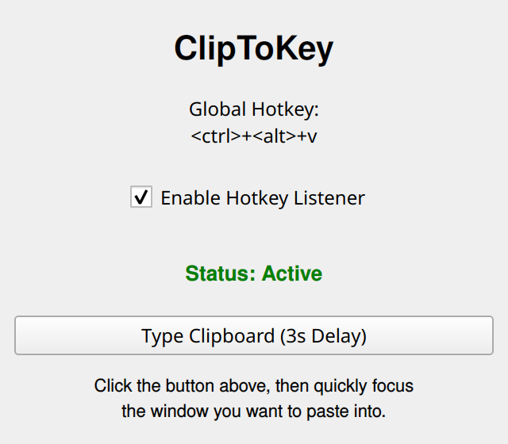
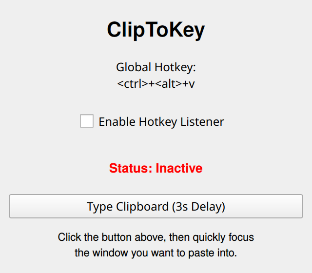

# ClipToKey

Types the contents of your clipboard as real keystrokes, for windows that refuse a normal paste: VM consoles (noVNC, Proxmox, VMware), IPMI/iDRAC/iLO KVM viewers, remote desktop sessions, and login screens.



## How it works

Copy text as usual, focus the window you want it typed into, and press **Ctrl+Alt+V**. ClipToKey reads the clipboard and sends it one key at a time, as if you were typing it.

Each key is held briefly, with a short pause before the next one. Remote consoles drop or reorder key events that arrive too fast, which loses characters and can leave Shift stuck, so the pacing matters more than raw speed. A 300-character command takes about 10 seconds.

## Requirements

- Linux with an X11 session. Wayland sessions do not allow the global hotkey or synthetic keystrokes this relies on.
- Python 3.10 or newer, with the `venv` module.

It is built on [pynput](https://pypi.org/project/pynput/) and [PySide6](https://pypi.org/project/PySide6/), which also run on macOS and Windows, but it has only been tested on Linux/X11.

## Install and run

```bash
git clone https://github.com/markmcjr/ClipToKey.git
cd ClipToKey
./run.sh
```

`run.sh` creates a virtual environment in `venv/` on first run, installs the two dependencies, and starts the app. The window stays on top of other windows.

## Usage

**Hotkey.** With the target window focused, press **Ctrl+Alt+V**. Release the keys promptly so they do not combine with the typed text.

**Delayed button.** Click **Type Clipboard (3s Delay)**, then focus the target window within three seconds. Use this when the target grabs the keyboard and the hotkey never reaches ClipToKey, which is common with full-screen remote sessions.

**Pausing.** Untick **Enable Hotkey Listener** to stop the hotkey from firing without closing the app. The delayed button keeps working.



Run only one copy at a time. Two running copies both answer the hotkey and type over each other.

## Configuration

Settings are constants at the top of `main.py`:

| Constant | Default | Meaning |
| --- | --- | --- |
| `HOTKEY` | `<ctrl>+<alt>+v` | Global hotkey, in pynput's hotkey syntax |
| `KEY_HOLD_SECONDS` | `0.015` | How long each key stays down |
| `KEY_GAP_SECONDS` | `0.015` | Pause after each key is released |

Restart the app after changing them.

## Troubleshooting

**Missing, reordered, or wrong-case characters.** The console is not keeping up. Raise `KEY_HOLD_SECONDS` and `KEY_GAP_SECONDS`, for example to `0.03` each.

**Everything arrives in capitals or as shifted symbols.** A modifier is stuck on the remote side, usually after an earlier garbled paste. Click into the console and tap Shift and Ctrl once each.

**Wrong symbols, such as `"` and `@` swapped.** The remote machine uses a different keyboard layout from yours. ClipToKey sends keys for your local layout, so the two layouts need to match.

**The hotkey does nothing.** Check that the listener is enabled, that you are on X11 rather than Wayland, and that the focused window is not grabbing the keyboard. Use the delayed button if it is.

## Security notes

- ClipToKey types whatever is on the clipboard, including line breaks, which a shell runs as Enter. Check what you copied before you trigger it.
- Text is typed into whichever window has focus at that moment.
- Nothing is stored, logged, or sent over the network. The clipboard is read only when you press the hotkey or the button.
